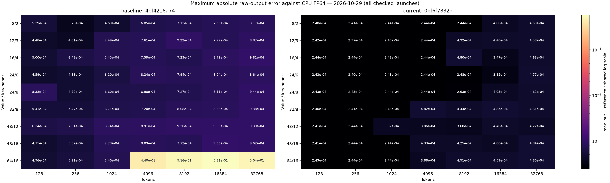

# GDN absolute-error heatmap

Measured 2026-10-29; baseline library `4bf4218a7473`, current `0bf6f7832dd1`.
Nonzero initial state: True; seed 0; gate scale 1.0; D=C=128.
Independent CPU FP64 token recurrence on actual rounded inputs. Every output/state element must satisfy
`abs(error) <= 0.0001 + 0.001*abs(reference)`, plus finiteness and relative RMSE < 0.005.
Current passes 63/63 shapes; baseline passes 0/63.

Maxima cover every raw-output element across checked warmups and after timing.
Final state is checked too, but is not plotted. This is the same ordinary-input
grid as the speed heatmap, not the adversarial regression suite.

## Accuracy regimes

The regular suite includes 178 fixed cases: ordinary Gaussian and FLA-style
positive inputs; beta endpoints and interior values; zero, tiny and strong
gates; correlated/nearly identical keys; large values and initial states;
packed/empty sequences and contexts through 32K. Each case uses five poisoned
scratch launches and checks inputs and output guards. The production uniform
kernel at `f381ae8` passed these cases under the fixed policy above. An
experimental candidate's ordinary-input grid does not certify its full suite.

These are measured regimes, not a guarantee for arbitrary inputs. Primary use
assumes normalized Q/K, beta in [0,1] and nonpositive log gates. A few exploratory
tests go beyond those assumptions. Strong correlation, large state/value
magnitudes and nearly lossless long recurrences are the most sensitive cases.

Under the older atol=1e-5, 23 of 160 historical stress cases failed. The largest
required absolute floor at rtol=1e-3 was 8.293e-5; the user approved atol=1e-4
and moved those cases into regular tests. This was a tolerance-policy change,
not a numerical fix. Failures were often small absolute errors near zero;
maximum error alone can also be dominated by unavoidable FP16 output rounding.
No clipping or case-specific thresholds are used.

Use the [benchmark tool](../../benchmarking/gdn_mega.py) (`python benchmarking/gdn_mega.py test`)
for validation. See [input ranges](input_ranges.md) for the captured workload.
