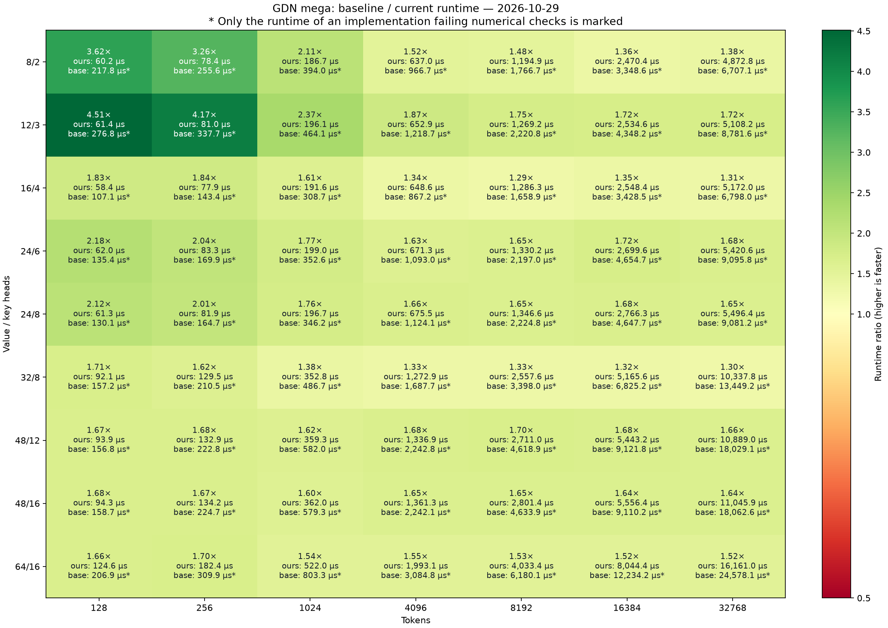

# GDN speed heatmap

Measured 2026-10-29; baseline library `4bf4218a7473`, current `0bf6f7832dd1`.
Nonzero initial state: True; seed 0; gate scale 1.0; D=C=128.
Independent CPU FP64 token recurrence on actual rounded inputs. Every output/state element must satisfy
`abs(error) <= 0.0001 + 0.001*abs(reference)`, plus finiteness and relative RMSE < 0.005.
Current passes 63/63 shapes; baseline passes 0/63.

Each cell shows runtime ratio and total median µs for both kernels. Asterisks
mark only failed implementations; those ratios are not accuracy-equivalent
speedups.

## Benchmark procedure (identical for both libraries)

1. For each shape, generate identical seed-0 inputs and the CPU FP64 reference.
   Copy inputs to the NPU and allocate outputs, masks, intermediates and all
   workspace **once**, using the same caller allocation helper for both libraries.
2. Run five warmup calls, checking raw output and final state after each call.
3. Capture an NPU graph containing **20 consecutive full kernel calls**.
   Replay that graph once without timing, then synchronize.
4. Measure **15 graph replays** with NPU start/end events. Divide each graph
   duration by 20; report the median of these 15 per-call averages.
   This is 300 timed calls, not individually timed Python-loop calls.
5. Check output and final state after the final timed replay, outside timing.

All calls reuse the same device addresses and input values. Each starts from
that shape's original supplied state (or zero when initial state is disabled);
final state is a separate output and is not fed into the next call. Scratch and
outputs are reused without external clearing between calls; initialization
required by the caller contract occurs before warmup.

The timed region covers the complete device kernel and graph execution overhead,
including the kernel's internal transfers and synchronization. It excludes
allocation/initialization, host-device input copies, CPU reference computation,
validation, graph capture and caller-side output scaling. Graph replay amortizes
submission overhead and avoids per-kernel Python dispatch gaps. No cache flush
is performed: these are warmed, repeated-buffer timings, not end-to-end request
latencies or guaranteed cold-cache timings.

Current and baseline run serially in separate processes. Their order alternates
between head configurations. Loaded-library hashes are verified, and matched
workers must agree on input/reference hashes, environment and accuracy policy.
Both libraries are freshly timed, including the original when it fails checks.

## Current median total microseconds

| H/Hg | 128 | 256 | 1024 | 4096 | 8192 | 16384 | 32768 |
|---|---:|---:|---:|---:|---:|---:|---:|
| 8/2 | 60.2 | 78.4 | 186.7 | 637.0 | 1194.9 | 2470.4 | 4872.8 |
| 12/3 | 61.4 | 81.0 | 196.1 | 652.9 | 1269.2 | 2534.6 | 5108.2 |
| 16/4 | 58.4 | 77.9 | 191.6 | 648.6 | 1286.3 | 2548.4 | 5172.0 |
| 24/6 | 62.0 | 83.3 | 199.0 | 671.3 | 1330.2 | 2699.6 | 5420.6 |
| 24/8 | 61.3 | 81.9 | 196.7 | 675.5 | 1346.6 | 2766.3 | 5496.4 |
| 32/8 | 92.1 | 129.5 | 352.8 | 1272.9 | 2557.6 | 5165.6 | 10337.8 |
| 48/12 | 93.9 | 132.9 | 359.3 | 1336.9 | 2711.0 | 5443.2 | 10889.0 |
| 48/16 | 94.3 | 134.2 | 362.0 | 1361.3 | 2801.4 | 5556.4 | 11045.9 |
| 64/16 | 124.6 | 182.4 | 522.0 | 1993.1 | 4033.4 | 8044.4 | 16161.0 |

## Scheduling tradeoff

The removed H8-specific schedule (`365b105`) used sixteen state-column workers
and eight preparation helpers. Matched H8/Hg2 measurements at 4K–32K showed
**22–27% lower latency (1.29–1.38× throughput)** than the uniform schedule.
It was removed for simplicity, saving 153 source lines; shared factored and
asynchronous joins remain. This is a historical comparison, not a guarantee
for arbitrary candidate libraries supplied to this script.

Use the [benchmark tool](../../benchmarking/gdn_mega.py) (`python benchmarking/gdn_mega.py --help`)
for reproduction. Raw run files are intentionally excluded from the documentation tree.
